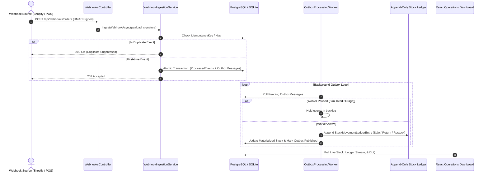

# StockBridge — Reconcile Inventory When Integrations Fail

[](https://github.com/your-username/StockBridge/actions)


An event-driven inventory operations platform that reconciles sales, returns, and supplier updates across omnichannel sales channels while detecting missing, duplicated, and conflicting events.

---

## 💼 The Problem & Real-World Use Case

A retailer sells inventory both **online** (e.g., Shopify) and **in-person** (e.g., Square POS). During peak volumes:
- Network timeouts cause webhooks to retry repeatedly, resulting in **duplicate deductions**.
- Offline POS transactions sync out of order, leading to **phantom stockouts**.
- Physical counts on the floor don't match database numbers, leaving operations staff with no clear audit trail.

**StockBridge** solves this with an **append-only stock movement ledger**, **transactional outbox worker**, **idempotent event ingestion**, and a **physical snapshot reconciliation engine**.

---

## 🎯 Resume Pitch

> *"Engineered an event-driven inventory reconciliation service using ASP.NET Core, PostgreSQL, and SQS/Outbox pattern, processing high-throughput simulated events with idempotent consumers, an append-only ledger, and verified recovery from duplicate delivery and worker failures."*

---

## 🏗️ Architecture & Data Flow



---

## ⚡ Advanced Engineering Features

| Feature | Technical Implementation |
| :--- | :--- |
| **Idempotent Processing** | Uses `IdempotencyKey` + SHA-256 payload hashes backed by database unique constraints. Duplicate deliveries return `200 OK (Duplicate Ignored)` without double-counting stock. |
| **Transactional Outbox** | State changes and outbound queue events are persisted atomically in the same database transaction. The background worker drains the outbox reliably. |
| **Append-Only Stock Ledger** | Inventory is modeled as an immutable stream of ledger movements (`Sale`, `Return`, `Restock`, `DamageAdjustment`, `ReconciliationAdjustment`). Current stock is a materialized sum that can always be audited or rebuilt. |
| **Physical Reconciliation Engine** | Uploads physical inventory CSV snapshots, computes variance against calculated ledger stock, provides root-cause diagnosis, and applies automated `ReconciliationAdjustment` entries upon staff approval. |
| **Failure Recovery & DLQ** | Failed messages retry up to 3 times with exponential backoff before being safely routed to a Dead-Letter Queue (DLQ). Operators can replay events directly from the UI without corrupting ledger state. |
| **Interactive Demo Simulator** | Built-in test suite to demonstrate concurrent duplicate bursts, out-of-order deliveries, and worker pause/resume backlog draining during technical interviews. |

---

## 🛠️ Full Tech Stack

| Layer | Technology |
| :--- | :--- |
| **Frontend** | React 18, TypeScript, TanStack Table v8, Recharts, Lucide Icons, Vite |
| **Backend** | C# .NET 8 LTS, ASP.NET Core Web API, Entity Framework Core |
| **Data Layer** | PostgreSQL (Production / Docker) & SQLite (Zero-setup local run) |
| **Workers & Queues** | .NET `BackgroundService` Outbox Worker, AWS SQS Adapter + In-Memory Channel fallback |
| **Security** | HMAC-SHA256 constant-time webhook signature verification |
| **Testing** | xUnit, FluentAssertions, SQLite in-memory integration tests |
| **Delivery** | Docker multi-stage build, Docker Compose, GitHub Actions CI |

---

## 🚀 Quickstart Guide

### Option 1: Run with Docker Compose (PostgreSQL + API + React)

Ensure Docker is running, then run:

```bash
docker compose up --build
```

- **Dashboard & API**: Open [http://localhost:5000](http://localhost:5000)
- **Swagger Documentation**: Open [http://localhost:5000/swagger](http://localhost:5000/swagger)

---

### Option 2: Run Locally (.NET SDK + Node.js)

StockBridge automatically uses SQLite out of the box when no PostgreSQL connection string is set, so you can run it with zero database setup!

#### 1. Start Backend API
```bash
cd src/StockBridge.Api
dotnet run --urls "http://localhost:5150"
```

#### 2. Start Frontend Dev Server
```bash
cd src/StockBridge.Web
npm install
npm run dev
```

Open [http://localhost:5173](http://localhost:5173) in your browser.

---

## 🧪 Running Automated Tests

```bash
dotnet test StockBridge.sln
```

Tests cover:
- Exactly-once ledger creation under duplicate webhook delivery
- Append-only balance convergence across sales, returns, and supplier restocks
- Physical CSV snapshot variance detection and automated adjustment resolution
- HMAC-SHA256 signature verification and tamper rejection

---

## 🎤 Interview Demo Script (Showcase in 3 Minutes)

Follow these steps to demonstrate the reliability and depth of this system during an interview:

1. **Demonstrate Concurrent Idempotency**:
   - In the **Interactive Demo Suite** at the top of the dashboard, click **"Simulate 5 Duplicate Webhooks"**.
   - Observe the notification: `5 requests dispatched -> 1 Accepted into Outbox, 4 Intercepted by Idempotency Filter`.
   - Switch to the **Append-Only Ledger** tab: confirm that stock decreased by exactly 2 units, not 10.

2. **Demonstrate Failure Recovery & Worker Backlog**:
   - Click **"Stop Worker (Simulate Outage)"**. The status changes to `PAUSED` and the outbox count turns blue.
   - Fire another webhook or out-of-order event. Watch pending messages safely accumulate in the Outbox without getting lost.
   - Click **"Resume Worker (Drain Backlog)"**: the worker instantly drains the outbox, updates the ledger, and the inventory converges.

3. **Demonstrate Physical Count Reconciliation**:
   - Switch to the **"Reconciliation & Exceptions"** tab.
   - Click **"Download Sample CSV"** and then **"Upload Physical Count CSV"**.
   - The engine flags variances (e.g., floor shrinkage vs surplus restocks) and provides an automated explanation.
   - Click **"Approve Adjustment"**: a `ReconciliationAdjustment` entry is appended to the ledger, bringing calculated stock and physical count into 100% convergence.

---

## 📄 License

MIT License. Designed and built for robust inventory operations and engineering portfolio excellence.
