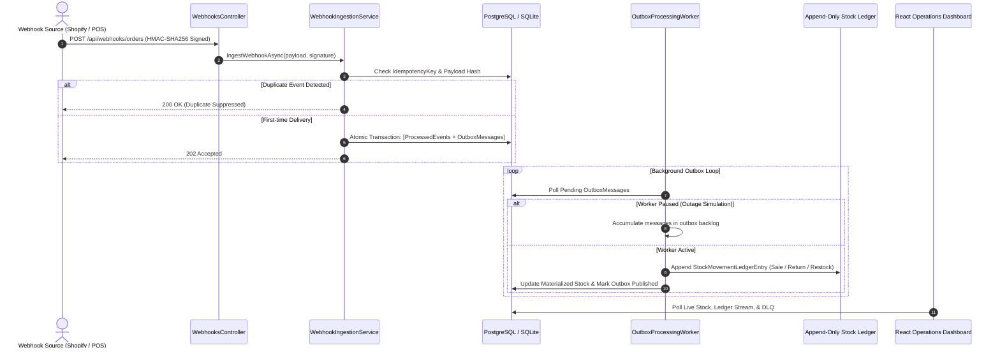

# StockBridge — Reconcile Inventory When Integrations Fail

[](https://github.com/tanak-pixel/StockBridge/actions)


An event-driven inventory operations service that reconciles sales, returns, and supplier updates across omnichannel sales channels while detecting missing, duplicated, and conflicting events.

---

## The Problem & Real-World Context

Retailers selling across both online storefronts (e.g., Shopify) and physical point-of-sale systems (e.g., Square POS) frequently encounter inventory discrepancies caused by network latency, duplicate webhook deliveries, and offline syncing:
- **Duplicate deliveries**: Retrying webhooks after network hiccups causes inventory to be decremented multiple times.
- **Out-of-order events**: Offline POS sales syncing hours later can conflict with intermediate supplier restocks.
- **Physical stock drift**: Physical inventory counts on the floor diverge from system records without an audit trail explaining why.

**StockBridge** addresses these failure modes using an **append-only stock movement ledger**, **transactional outbox worker**, **idempotent event ingestion**, and a **physical count reconciliation engine**.

---

## Architecture & Data Flow



---

## Core Reliability Mechanisms

| Mechanism | Technical Implementation |
| :--- | :--- |
| **Idempotent Ingestion** | Uses `IdempotencyKey` + SHA-256 payload hashes backed by database unique constraints. Duplicate deliveries return `200 OK` with duplicate telemetry without modifying inventory. |
| **Transactional Outbox** | State changes and outbound queue events are persisted atomically in the same database transaction. The background worker drains the outbox reliably. |
| **Append-Only Stock Ledger** | Inventory is modeled as an immutable stream of ledger movements (`Sale`, `Return`, `Restock`, `DamageAdjustment`, `ReconciliationAdjustment`). Current stock is a materialized sum that can always be audited or rebuilt. |
| **Physical Reconciliation Engine** | Ingests physical inventory CSV snapshots, computes variance against calculated ledger stock, provides possible-cause diagnostics, and applies automated `ReconciliationAdjustment` entries upon staff approval. |
| **Failure Recovery & DLQ** | Messages that fail worker processing retry up to 3 times before being safely routed to a Dead-Letter Queue (DLQ). Operators can replay events directly from the UI without corrupting ledger state. |
| **Interactive Demo Simulator** | Built-in test suite to demonstrate concurrent duplicate bursts, out-of-order deliveries, and worker pause/resume backlog draining. |

---

## Tech Stack

| Layer | Technology |
| :--- | :--- |
| **Frontend** | React 18, TypeScript, TanStack Table v8, Recharts, Lucide Icons, Vite |
| **Backend** | C# .NET 8 LTS, ASP.NET Core Web API, Entity Framework Core |
| **Data Layer** | PostgreSQL (Production / Docker) & SQLite (Zero-setup local run) |
| **Workers & Queues** | .NET `BackgroundService` Outbox Worker, AWS SQS Adapter + In-Memory Channel fallback |
| **Security** | HMAC-SHA256 constant-time webhook signature verification |
| **Testing** | xUnit, FluentAssertions, SQLite in-memory integration tests |
| **Delivery** | Docker multi-stage build, Docker Compose, GitHub Actions CI |

---

## Quickstart Guide

### Option 1: Run with Docker Compose (PostgreSQL + API + React)

```bash
docker compose up --build
```

- **Dashboard & API**: Open [http://localhost:5000](http://localhost:5000)
- **Swagger Documentation**: Open [http://localhost:5000/swagger](http://localhost:5000/swagger)

---

### Option 2: Run Locally (.NET SDK + Node.js)

StockBridge automatically uses SQLite when no PostgreSQL connection string is set, allowing local runs without external database dependencies.

#### 1. Start Backend API
```bash
dotnet run --project src/StockBridge.Api/StockBridge.Api.csproj --urls "http://localhost:5150"
```

#### 2. Start Frontend Dev Server
```bash
cd src/StockBridge.Web
npm install
npm run dev
```

Open [http://localhost:5173](http://localhost:5173) in your browser.

---

## Automated Test Suite

Run the full xUnit test suite from the repository root:

```bash
dotnet test StockBridge.sln
```

### Key Test Coverage:
1. **Concurrent Duplicate Delivery (`HighThroughputBurst_DeduplicatesConcurrentDeliveries_AndConvergesLedger`)**:
   Fires 50 simultaneous webhook deliveries across 5 orders with duplicate keys; verifies exactly 5 ledger rows are recorded and final stock converges accurately.
2. **Safe DLQ Replay (`SafeReplayFromDlq_ReplaysFailedEvent_WithoutDoubleCounting`)**:
   Simulates 3 worker failures moving an event to DLQ, recovers the event via replay, and confirms that accidental multiple replays do not double-deduct stock.
3. **Out-of-Order Delivery (`OutOfOrderEvents_ArriveChronologicallyInverted_LedgerConvergesAccurately`)**:
   Simulates a sale arriving 30 minutes after an inbound restock despite occurring earlier; confirms the append-only ledger preserves all transitions and converges.
4. **Physical Count Reconciliation (`ReconciliationEngine_DetectsDiscrepancies_AndAppliesAdjustment`)**:
   Compares physical CSV scans against ledger calculations, diagnoses possible causes (e.g., shrinkage vs. unrecorded shipment), and applies a balancing adjustment entry.
5. **HMAC-SHA256 Webhook Verification (`HmacSignatureVerifier_ValidatesAuthenticPayload_AndRejectsTamperedPayload`)**:
   Tests constant-time validation of authentic headers and rejection of tampered payloads.

---

## Live Demonstration Walkthrough

1. **Test Concurrent Duplicate Delivery**:
   - In the **Interactive Demo Suite** at the top of the dashboard, click **"Simulate 5 Duplicate Webhooks"**.
   - The notification confirms: `5 requests dispatched -> 1 Accepted into Outbox, 4 Intercepted by Idempotency Filter`.
   - In the **Append-Only Ledger** tab, verify that stock decreased by exactly 2 units, not 10.

2. **Test Worker Outage & Backlog Recovery**:
   - Click **"Stop Worker (Simulate Outage)"**. Status switches to `PAUSED` and the outbox count turns blue.
   - Fire another webhook or out-of-order event; watch pending messages safely accumulate in the Outbox without being dropped.
   - Click **"Resume Worker (Drain Backlog)"**: the worker drains the queue and inventory converges to the expected value.

3. **Test Physical Stock Reconciliation**:
   - Open the **"Reconciliation & Exceptions"** tab.
   - Click **"Download Sample CSV"** and then **"Upload Physical Count CSV"**.
   - The engine flags variances and outlines possible causes (e.g., unrecorded deliveries or floor shrinkage).
   - Click **"Approve Adjustment"**: a `ReconciliationAdjustment` row is appended to the ledger, bringing calculated stock and physical count into alignment.

---

## License

MIT License.
